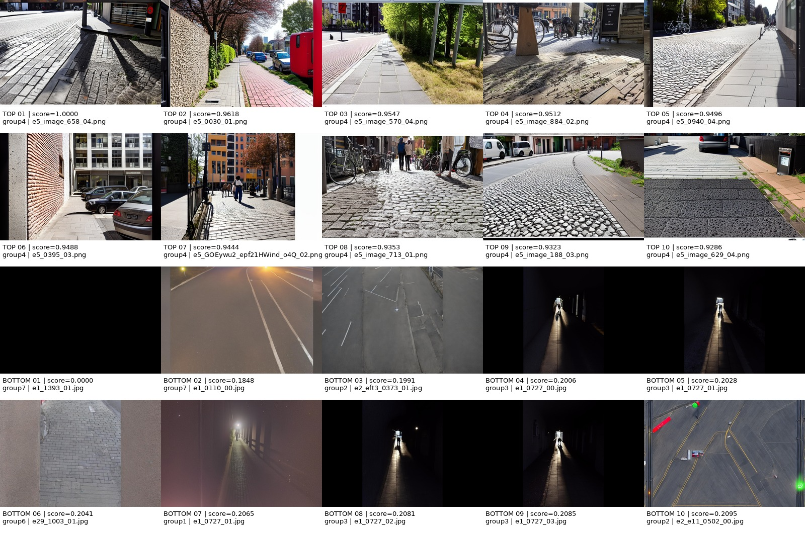

# Group 2 — Perceptual Image Quality

## Research question

With a fixed budget of **548 synthetic images**, does perceptual-quality selection improve
semantic segmentation on real road scenes?

The downstream protocol is DeepLabV3+ with seeds 17, 42 and 73, compared with
`real_only` and `random_budget_0.25x`. Downstream training has not been run yet.

## Phase-submission contents

| Required item | Submitted file | Status |
| --- | --- | --- |
| README | `group-2/README.md` | Complete |
| Generated manifest | `group-2/manifest.jsonl` | 78,883 rows; course schema `1.1` |
| Strategy | `group-2/results/fallback-v1/perceptual_quality_budget_0.25x.jsonl` | Course subset schema `1.0`; exactly 548 rows |
| Runnable code | `group-2/src/group_2/` and `group-2/scripts/` | Complete and tested |

The course format is JSON Lines, so the submitted manifest is named `manifest.jsonl`
rather than `manifest.json`. It is an exact submission copy of the generated canonical
manifest. SHA-256:

```text
f50ef57736713ff9f9c83950ad453acf4501719358056cd4ad8d4ce2275fdf8e
```

The original was generated by our `group-2/scripts/build_manifest.slurm`, which ran:

```bash
python -m sensation_seminar.cli.build_manifest \
  --data-root datasets \
  --output synthetic-data-seminar/manifest.jsonl
```

FAU Woody Job `12841196` completed successfully on 2026-11-03 and is preserved in
`group-2/logs/build-manifest-12841196.out`. It reports 78,883 total, 78,840 analysis and
43,800 training-eligible records. `group-2/manifest.jsonl` was copied byte-for-byte from
that generated file only to make the ignored canonical artifact available in the phase
submission; it was not downloaded or fabricated.

### Manifest submission note

We remember that the instructor asked us in class last Friday to generate the Manifest
and place it in the code repository. However, the course documentation also explicitly
states that generated Manifests should be ignored by Git. These two requirements appear
to conflict, and we cannot currently determine the instructor's final intention. To make
sure this phase submission contains the file requested verbally, we have temporarily
included the Manifest that we generated and validated on FAU Woody. We can adjust this
decision after receiving the instructor's feedback.

## Methodology and results

| Method | Description | Current result |
| --- | --- | --- |
| 1. Contrast-gradient fallback | Grayscale standard deviation plus horizontal and vertical absolute gradients; higher is better | **Complete:** 78,840 scores, 0 skipped, deterministic Top-548 |
| 2. NIQE | pyiqa no-reference natural-scene-statistics metric; raw score is lower-is-better | Code and real HPC smoke test complete; **no full result yet** |
| 3. BRISQUE | pyiqa no-reference spatial natural-scene-statistics metric; raw score is lower-is-better | Code and real HPC smoke test complete; **no full result yet** |

The completed fallback score is:

```python
gray = np.mean(rgb, axis=2)
raw_score = (
    np.std(gray)
    + np.mean(np.abs(np.diff(gray, axis=0)))
    + np.mean(np.abs(np.diff(gray, axis=1)))
)
```

Scores are min-max normalized to `[0, 1]`. Selection keeps records with both
`eligibility.analysis=true` and `eligibility.segmentation_training=true`, sorts by
`(-score, synthetic_id)`, and selects exactly 548 images.

The submitted Strategy follows subset schema `1.0` and records `synthetic_id`, selection
rank, method, budget, seed, source group, score method/version and exact manifest SHA-256.

NIQE and BRISQUE use `pyiqa==0.1.16`. Their raw values are saved first and converted to
normalized higher-is-better scores only after the complete image pool has been processed.
Both real HPC smoke tests processed 8/8 images with zero skips. Full results are not yet
available because the current safe one-image-at-a-time pipeline is slow: processing all
78,840 images is expected to take **tens of hours** and may require several resumed HPC
jobs. Smoke outputs are not reported as research results.

## How to Run

All commands below start at the repository root. Full Manifest generation, fallback
scoring and training require the course Dataset and should run on an HPC compute node;
do not run them on the login node.

### 1. Environment

```bash
# On FAU Woody first run: module load python/3.12-conda
python3 -m venv group-2/.venv
group-2/.venv/bin/python -m pip install --upgrade pip
group-2/.venv/bin/python -m pip install -e ".[dev]"
export PYTHONDONTWRITEBYTECODE=1
export PYTHONPATH="$PWD/src:$PWD/group-2/src"
```

### 2. Generate the Manifest (HPC compute node)

The verified historical command used `--data-root datasets`. The following reproduction
writes to `/tmp` and therefore does not overwrite the submitted Manifest:

```bash
group-2/.venv/bin/python -m sensation_seminar.cli.build_manifest \
  --data-root datasets \
  --output /tmp/group2-manifest.jsonl

group-2/.venv/bin/python group-2/scripts/validate_results.py \
  --manifest /tmp/group2-manifest.jsonl
```

The validator also checks the submitted fallback artifacts, so the regenerated Manifest
must be byte-identical to the submitted one. The original successful HPC wrapper is
`group-2/scripts/build_manifest.slurm`; its `#SBATCH --chdir` must match the user's own
checkout before submission.

### 3. Contrast-gradient scoring and Top-548 (HPC compute node)

There is no separate selection CLI: `group_2.cli` first scores every
`eligibility.analysis=true` image, normalizes the complete valid pool, then creates the
deterministic training-eligible Top-548. New output paths protect the formal result:

```bash
mkdir -p /tmp/group2-fallback

group-2/.venv/bin/python -m group_2.cli \
  --data-root datasets \
  --manifest group-2/manifest.jsonl \
  --scores-output /tmp/group2-fallback/scores.jsonl \
  --subset-output /tmp/group2-fallback/perceptual_quality_budget_0.25x.jsonl
```

The verified full run took approximately 2 hours 4 minutes. Do not add `--overwrite`
unless replacing an output is intentional.

### 4. Validate results

Validation of the submitted result does not require access to the source images:

```bash
group-2/.venv/bin/python group-2/scripts/validate_results.py \
  --manifest group-2/manifest.jsonl
```

Validate a newly reproduced score/subset pair with:

```bash
group-2/.venv/bin/python group-2/scripts/validate_results.py \
  --manifest group-2/manifest.jsonl \
  --scores /tmp/group2-fallback/scores.jsonl \
  --subset /tmp/group2-fallback/perceptual_quality_budget_0.25x.jsonl
```

This checks Manifest schema `1.1`, the score overlay, min-max normalization, exact
Top-548 reconstruction, Manifest SHA-256 and compatibility with
`SyntheticSegmentationDataset`.

### 5. Official training configuration (not run yet)

The shared trainer loads `configs/experiments/<experiment>.yaml`. Before training, create
`configs/experiments/perceptual_quality_budget_0.25x.yaml` with:

```yaml
experiment: perceptual_quality_budget_0.25x
synthetic_subset: group-2/results/fallback-v1/perceptual_quality_budget_0.25x.jsonl
synthetic_manifest: group-2/manifest.jsonl
synthetic_budget: budget_0.25x
synthetic_samples: 548
required_before_seminar: false
```

Then run each seed on an HPC compute node with the official entry point:

```bash
group-2/.venv/bin/python -m sensation_seminar.cli.train \
  --experiment perceptual_quality_budget_0.25x \
  --seed 17 \
  --data-root datasets/sensation_ds_v2_1_1152x768 \
  --output-root group-2/results/training \
  --checkpoint-root group-2/checkpoints
```

Repeat with seeds `42` and `73`. This DeepLabV3+ training has **not** been run. Generated
reproduction outputs, checkpoints and training results are large runtime artifacts and
should not be added to Git. The submitted `group-2/manifest.jsonl` is the temporary
exception explained in the Manifest submission note above.

## Completed fallback result

| Output | Result |
| --- | --- |
| `results/fallback-v1/scores.jsonl` | 78,840 normalized scores |
| `results/fallback-v1/perceptual_quality_budget_0.25x.jsonl` | 548 unique selected IDs |
| `results/fallback-v1/top_bottom_examples.jpg` | Global Top-10/Bottom-10 visualization |
| `results/fallback-v1/source_group_distribution.csv` | group3: 309; group5: 141; group7: 69; group9: 29 |
| `results/fallback-v1/source_group_eligibility_and_selection.csv` | Eligibility and selection rates for groups 1–9 |



These are image-quality selection results, not segmentation-performance results.

## Project structure

### Folders

| Folder | Purpose |
| --- | --- |
| `src/group_2/` | Scoring and selection code |
| `scripts/` | Validation and analysis entry points |
| `scripts/hpc/` | NIQE/BRISQUE HPC execution |
| `tests/` | Automated tests |
| `results/fallback-v1/` | Completed formal fallback results |
| `logs/` | Historical Slurm logs |

### Files

| File | Purpose |
| --- | --- |
| `README.md` | English project summary |
| `readme-chinese.md` | Chinese project summary |
| `HPC_NIQE_BRISQUE.md` | HPC run instructions |
| `manifest.jsonl` | Submitted canonical manifest |
| `requirements-iqa.txt` | NIQE/BRISQUE dependencies |
| `.gitignore` | Local IQA environment exclusions |
| `src/group_2/perceptual_quality.py` | Fallback score and Top-548 |
| `src/group_2/cli.py` | Fallback CLI |
| `src/group_2/nr_iqa.py` | NIQE/BRISQUE pipeline |
| `src/group_2/nr_iqa_cli.py` | NIQE/BRISQUE CLI |
| `src/group_2/metric_comparison.py` | Metric comparison statistics and plots |
| `scripts/build_manifest.slurm` | Manifest generation job |
| `scripts/score_quality.slurm` | Fallback scoring job |
| `scripts/make_quality_report.py` | Fallback figure and CSV report |
| `scripts/validate_results.py` | Formal-result validation |
| `scripts/compare_metrics.py` | Three-metric comparison CLI |
| `scripts/hpc/run_nr_iqa.sh` | Shared HPC runtime |
| `scripts/hpc/score_niqe.slurm` | NIQE Slurm template |
| `scripts/hpc/score_brisque.slurm` | BRISQUE Slurm template |
| `tests/test_group_2.py` | Fallback and shared-interface tests |
| `tests/test_nr_iqa.py` | NIQE/BRISQUE and comparison tests |
| `results/README.md` | Result-status rules |
| `results/fallback-v1/scores.jsonl` | Formal fallback scores |
| `results/fallback-v1/perceptual_quality_budget_0.25x.jsonl` | Formal fallback Top-548 |
| `results/fallback-v1/top_bottom_examples.jpg` | Fallback visualization |
| `results/fallback-v1/source_group_distribution.csv` | Selected-source distribution |
| `results/fallback-v1/source_group_eligibility_and_selection.csv` | Per-source selection statistics |
| `logs/build-manifest-12841194.out` | Failed first manifest attempt |
| `logs/build-manifest-12841196.out` | Successful manifest run |
| `logs/score-quality-12841210.out` | Successful fallback run |

## Validation

- Local automated tests: **39 passed, 2 skipped**.
- Submitted manifest: **78,883 schema-1.1 rows**.
- Strategy schema: **548 unique, ranked, training-eligible rows**.
- NIQE HPC smoke: **8 valid, 0 skipped**.
- BRISQUE HPC smoke: **8 valid, 0 skipped**.
- Formal fallback validation: **78,840 scores and exactly 548 selected records**.

## Incomplete experiments

- Full-pool NIQE and BRISQUE scoring and their Top-548 subsets.
- Correlation and overlap analysis across all three metrics.
- DeepLabV3+ training for seeds 17, 42 and 73.
- Comparison with `real_only` and `random_budget_0.25x`.

## Next steps

1. Resume NIQE and BRISQUE until all 78,840 images are processed.
2. Generate their normalized scores, Top-548 subsets and comparison plots.
3. Compare correlations, Top-548 overlap and source-group selection rates.
4. Train DeepLabV3+ with seeds 17, 42 and 73.
5. Compare with `real_only` and `random_budget_0.25x` on real validation/test data.

Quality-score improvement or agreement between IQA metrics must not be interpreted as
segmentation improvement before the downstream experiments are complete.
