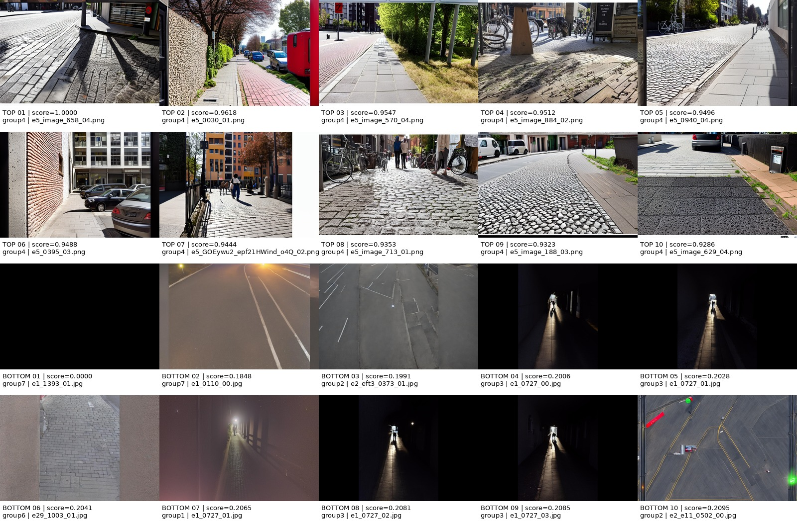

# Group 2：感知图像质量筛选

## 研究问题

在合成图片预算固定为 **548 张**时，按照感知质量选择合成图片，是否能够提高真实
道路场景的语义分割性能？

下游实验计划使用 DeepLabV3+，种子为17、42、73，并与 `real_only` 和
`random_budget_0.25x` 比较。目前尚未运行下游训练。

## 阶段性提交内容

| 老师要求 | 提交文件 | 状态 |
| --- | --- | --- |
| README | `group-2/README.md` | 已完成 |
| 自己生成的 Manifest | `group-2/manifest.jsonl` | 78,883条；课程schema `1.1` |
| Strategy | `group-2/results/fallback-v1/perceptual_quality_budget_0.25x.jsonl` | 课程subset schema `1.0`；恰好548条 |
| 可直接运行的代码 | `group-2/src/group_2/`、`group-2/scripts/` | 已完成并测试 |

课程实际使用 JSON Lines 格式，因此文件名为 `manifest.jsonl`，不是单个JSON数组。
它是已生成 canonical manifest 的同字节提交副本。SHA-256：

```text
f50ef57736713ff9f9c83950ad453acf4501719358056cd4ad8d4ce2275fdf8e
```

原始文件由我们自己的 `group-2/scripts/build_manifest.slurm` 生成，实际执行：

```bash
python -m sensation_seminar.cli.build_manifest \
  --data-root datasets \
  --output synthetic-data-seminar/manifest.jsonl
```

FAU Woody Job `12841196` 于2026-11-03成功完成，日志保存在
`group-2/logs/build-manifest-12841196.out`，记录了78,883条总记录、78,840条analysis
记录和43,800条训练合格记录。`group-2/manifest.jsonl` 只是为了让被根目录规则忽略的
canonical产物进入阶段提交而制作的同字节副本，不是下载或伪造的数据。

### Manifest 提交说明

我们记得老师上周五在课堂上要求我们生成 Manifest 并将其放到代码仓库中，但课程文档
又明确说明生成的 Manifest 应被 Git 忽略。这两项要求似乎存在矛盾，目前我们无法确定
老师的最终意图。因此，为了确保本次阶段性提交包含老师口头要求的文件，我们决定暂时
将自己在 FAU Woody 上生成并验证的 Manifest 一并提交，后续可根据老师的反馈调整。

## 方法和结果

### 主要方法决定 — 2026-11-10

**Contrast-gradient fallback v1 是本组论文和 Task 2 的主要方法。**
我们选择这个透明、计算成本可行的质量代理指标，检验基于对比度和梯度的筛选能否改善
下游分割。它的全量分数和准确的 Top-548 已经能够复现，但这尚不代表感知质量或分割
性能更优。本决定记录于下游训练和测试集评价之前，不会根据哪个指标取得最佳测试结果
来更换主要方法。

主要实验仍为 `perceptual_quality_budget_0.25x`，使用 `perceptual_fallback` 版本 `1`
及现有 `results/fallback-v1/perceptual_quality_budget_0.25x.jsonl`。为兼容已有产物，
保留名称中的“fallback”；它不再表示主要方法将被其他指标替代。公式、归一化和已选定的
548 张图片均保持不变。

NIQE 和 BRISQUE 定位为计划中的**独立补充指标比较**，完成全量评分后各自产生 Top-548。
我们不将它们的分数与主要方法融合，也不根据它们的下游结果重新选择主要方法。
完成这两项补充工作不是开展 fallback 主要实验的前提。主要比较仍使用 DeepLabV3+、
种子17、42、73以及真实验证/测试数据，对照 `real_only` 和 `random_budget_0.25x`。

| 方法 | 说明 | 当前结果 |
| --- | --- | --- |
| 1. Contrast-gradient fallback — 主要方法 | 灰度标准差加水平、垂直绝对梯度；越高越好 | **评分/筛选已完成：** 78,840条分数、0 skipped、确定性Top-548；下游训练待完成 |
| 2. NIQE — 补充比较 | pyiqa无参考自然场景统计指标；原始分数越低越好 | 代码和真实HPC Smoke Test已完成；**尚无全量结果** |
| 3. BRISQUE — 补充比较 | pyiqa无参考空间自然场景统计指标；原始分数越低越好 | 代码和真实HPC Smoke Test已完成；**尚无全量结果** |

### 主要分数与固定筛选规则

正式图片通过 Pillow `convert("RGB")` 解码（8位像素，范围0–255）；alpha 被丢弃，
不与背景合成。计算使用 `float64`，不重新缩放像素数值。灰度为 RGB 算术平均值，
标准差使用 `ddof=0`。保留图片原始尺寸，不进行 resize、裁剪或 EXIF 旋转。

已经完成正式结果的 fallback 公式为：

```python
gray = np.mean(rgb, axis=2)
raw_score = (
    np.std(gray)
    + np.mean(np.abs(np.diff(gray, axis=0)))
    + np.mean(np.abs(np.diff(gray, axis=1)))
)
```

令 `P` 为固定 Manifest 中成功评分的全部 analysis 合格图片，
`a = min(raw_score in P)`，`b = max(raw_score in P)`。
当 `b > a` 时，`score = (raw_score - a) / (b - a)`；当 `b == a` 时，全部设为
`score = 1`。极值来自完整有效 analysis 池，在训练资格过滤之前计算。筛选只保留同时
满足 `eligibility.analysis=true` 和 `eligibility.segmentation_training=true` 的记录，
按 `(-score, synthetic_id)` 排序，固定选择548张。有效训练候选不足548张则报错。

无法读取/缺失图片、无效或非有限像素/分数以及小于2×2的图片会被跳过，fallback CLI
会报告原因；重复 canonical ID 会被拒绝。正式验证器要求分数覆盖每个 analysis 合格ID；
现有运行已通过验证，共78,840条分数、0 skipped。存在缺失分数的运行必须先调查原因，
才能判断是否属于等价复现。

**局限性与来源策略：** 三个原始分量的系数均为1，没有分别归一化，因此较大尺度的分量
可能主导评分。噪声、光晕、过度锐化和文字类伪影可能提高代理分数。全局 min-max 对
异常极值敏感。筛选保证 `synthetic_id` 唯一，但不限制每个 `original_id` 的入选数量，
不进行 variant/内容去重，也没有来源组配额。需要分析并报告来源/变体集中度；修改这些
规则会构成独立实验，不属于已固定的 v1 筛选。

提交的Strategy符合subset schema `1.0`，包含 `synthetic_id`、rank、method、budget、
seed、source group、score method/version和准确的Manifest SHA-256。
其中 `seed=42` 仅为元数据；确定性 Top-548 不使用随机抽样。

NIQE 和 BRISQUE 使用 `pyiqa==0.1.16`。先保存原始分数，只有完整评分池处理完毕后
才统一转换为越高越好的归一化分数。两个真实HPC Smoke Test均完成8/8张图片、
0 skipped。它们目前没有全量结果，因为当前逐张安全评分流程较慢，处理78,840张
预计需要**数十小时**，可能需要多次HPC断点恢复。Smoke输出不作为正式研究结果。

### 补充指标的精确定义

对每个指标独立计算：扫描完全部 Manifest 后，令 `a`、`b` 为成功评分的全部 analysis
合格图片中有限原始分数的最小值、最大值。方向由运行时 `lower_better` 元数据决定：
越低越好时 `score = 1 - (raw - a)/(b - a)`，否则
`score = (raw - a)/(b - a)`。当 `a == b` 时所有有效分数均为 `1`；有效池为空则无法
产生 Top-548。不按来源分别归一化，不做百分位截断、缺失分数填补、加权融合或根据
测试成绩选择指标。每个独立筛选器沿用主方法的资格、预算和平分排序规则。

固定版本 `pyiqa==0.1.16` 的路径接口将文件转换为 `[0,1]` RGB 张量，丢弃 alpha，
增加 batch 维度。我们的包装层不增加 resize、裁剪或 EXIF 旋转。
NIQE 内部使用 YIQ 亮度、取整和 float64，裁剪为完整96×96块，并在两个尺度提取特征。
BRISQUE 使用两个尺度的亮度统计、内部半尺寸重采样和预训练 SVR。这些库内部操作与
fallback 预处理不同。实现细节已按固定版本的上游
[输入接口](https://github.com/chaofengc/IQA-PyTorch/blob/v0.1.16/pyiqa/models/inference_model.py)、
[NIQE](https://github.com/chaofengc/IQA-PyTorch/blob/v0.1.16/pyiqa/archs/niqe_arch.py)、
[BRISQUE](https://github.com/chaofengc/IQA-PyTorch/blob/v0.1.16/pyiqa/archs/brisque_arch.py)
源码核对。

缺失/损坏图片、库异常及 NaN/Inf 原始分数写为带原因的 `skipped` checkpoint 记录。
部分运行不发布归一化分数或 subset。扫描完全部记录后，现有管线即使有跳过也可能按
有限分数池发布产物，因此 `completion.json` 表示扫描完成，不代表评分池与 fallback
一致。正式比较前须检查 `skipped.jsonl` 和 `pool_consistency.json`。不一致必须调查并
明确报告，相关性只使用共同有效 ID。差异未解决或未在训练前明确修订比较协议时，不能
声称完成了相同评分池实验。运行版本、方向和设备记录于 `run.json` 和分数 provenance，
恢复运行时会检查一致性。

### Task 1 反馈：已完成的集中度分析

固定548张子集覆盖 **298个原始场景**；其中102个场景入选多张，合计352张；单个场景
最多入选7张。548个 `(source_group, original_id, variant)` 组合互不相同，但没有内容
哈希，无法确认像素内容是否完全重复。五个训练候选组各占20%，入选后group3占56.39%
（候选占比的2.82倍），group8为0。因此质量筛选与来源/变体分布存在混杂；这些统计
不能证明某个生成组更好或分割性能提高。

详见[反馈回应报告](FEEDBACK_TASK1_RESPONSE.md)和
[分析摘要](analysis/task1-feedback-v1/summary.json)。从仓库根目录复现到新目录：

```bash
PYTHONDONTWRITEBYTECODE=1 PYTHONPATH=src:group-2/src \
  group-2/.venv/bin/python group-2/scripts/audit_selection.py \
  --output-dir group-2/analysis/task1-feedback-reproduction
```

脚本只读 Manifest 和现有 JSONL，核对固定 Top-548、计算输入哈希，输出来源组、文件夹、
原始场景和 variant 的 JSON/CSV 统计；输出目录已存在则拒绝覆盖。稳健归一化以及新的
去重/配额规则暂列为可选消融实验，不改变主要 v1。

## 运行方法

以下命令均从仓库根目录开始执行。完整 Manifest 生成、fallback 评分和训练需要课程
Dataset，应在 HPC 计算节点运行，不要在登录节点运行。

### 1. 环境配置

```bash
# FAU Woody 上先执行：module load python/3.12-conda
python3 -m venv group-2/.venv
group-2/.venv/bin/python -m pip install --upgrade pip
group-2/.venv/bin/python -m pip install -e ".[dev]"
export PYTHONDONTWRITEBYTECODE=1
export PYTHONPATH="$PWD/src:$PWD/group-2/src"
```

### 2. 生成 Manifest（HPC 计算节点）

已经验证的历史命令使用 `--data-root datasets`。下面的复现命令写入 `/tmp`，不会覆盖
已提交的 Manifest：

```bash
group-2/.venv/bin/python -m sensation_seminar.cli.build_manifest \
  --data-root datasets \
  --output /tmp/group2-manifest.jsonl

group-2/.venv/bin/python group-2/scripts/validate_results.py \
  --manifest /tmp/group2-manifest.jsonl
```

验证器也会检查已提交的 fallback 产物，因此重新生成的 Manifest 必须与提交版本逐字节
一致。原始成功的 HPC 包装脚本为 `group-2/scripts/build_manifest.slurm`；提交前必须把
其中的 `#SBATCH --chdir` 改为使用者自己的项目路径。

### 3. Contrast-gradient 评分与 Top-548（HPC 计算节点）

项目没有重复的独立筛选 CLI：`group_2.cli` 先评分全部
`eligibility.analysis=true` 图片，在完整有效池上归一化，然后生成确定性的训练合格
Top-548。下面使用新输出路径保护正式结果：

```bash
mkdir -p /tmp/group2-fallback

group-2/.venv/bin/python -m group_2.cli \
  --data-root datasets \
  --manifest group-2/manifest.jsonl \
  --scores-output /tmp/group2-fallback/scores.jsonl \
  --subset-output /tmp/group2-fallback/perceptual_quality_budget_0.25x.jsonl
```

已经验证的完整运行约用时2小时4分钟。除非确实要替换输出，否则不要添加
`--overwrite`。

### 4. 结果验证

验证已提交结果不需要访问源图片：

```bash
group-2/.venv/bin/python group-2/scripts/validate_results.py \
  --manifest group-2/manifest.jsonl
```

验证新复现的分数和 subset：

```bash
group-2/.venv/bin/python group-2/scripts/validate_results.py \
  --manifest group-2/manifest.jsonl \
  --scores /tmp/group2-fallback/scores.jsonl \
  --subset /tmp/group2-fallback/perceptual_quality_budget_0.25x.jsonl
```

该流程检查 Manifest schema `1.1`、score overlay、min-max归一化、准确的Top-548重建、
Manifest SHA-256，以及与 `SyntheticSegmentationDataset` 的兼容性。

### 5. 官方训练配置（尚未运行）

公共训练入口读取 `configs/experiments/<experiment>.yaml`。训练前需要创建
`configs/experiments/perceptual_quality_budget_0.25x.yaml`，内容为：

```yaml
experiment: perceptual_quality_budget_0.25x
synthetic_subset: group-2/results/fallback-v1/perceptual_quality_budget_0.25x.jsonl
synthetic_manifest: group-2/manifest.jsonl
synthetic_budget: budget_0.25x
synthetic_samples: 548
required_before_seminar: false
```

然后在 HPC 计算节点通过官方入口分别运行每个种子：

```bash
group-2/.venv/bin/python -m sensation_seminar.cli.train \
  --experiment perceptual_quality_budget_0.25x \
  --seed 17 \
  --data-root datasets/sensation_ds_v2_1_1152x768 \
  --output-root group-2/results/training \
  --checkpoint-root group-2/checkpoints
```

将种子替换为 `42` 和 `73` 后重复运行。该 DeepLabV3+ 训练**尚未执行**。复现输出、
checkpoint 和训练结果属于大型运行产物，不应加入 Git；已提交的
`group-2/manifest.jsonl` 是上方 Manifest 提交说明中解释的暂时例外。

## 已有的 fallback 正式结果

| 输出 | 结果 |
| --- | --- |
| `results/fallback-v1/scores.jsonl` | 78,840条归一化分数 |
| `results/fallback-v1/perceptual_quality_budget_0.25x.jsonl` | 548个唯一入选ID |
| `results/fallback-v1/top_bottom_examples.jpg` | 全局Top-10/Bottom-10可视化 |
| `results/fallback-v1/source_group_distribution.csv` | group3: 309；group5: 141；group7: 69；group9: 29 |
| `results/fallback-v1/source_group_eligibility_and_selection.csv` | group1–group9资格与入选率 |



以上是质量评分与筛选结果，不是语义分割性能结果。

## 项目结构

### 文件夹

| 文件夹 | 用途 |
| --- | --- |
| `src/group_2/` | 评分与筛选代码 |
| `scripts/` | 验证与分析入口 |
| `scripts/hpc/` | NIQE/BRISQUE HPC运行 |
| `tests/` | 自动化测试 |
| `analysis/task1-feedback-v1/` | 只读集中度分析产物 |
| `results/fallback-v1/` | 已完成的fallback正式结果 |
| `logs/` | 历史Slurm日志 |

### 文件

| 文件 | 用途 |
| --- | --- |
| `README.md` | 英文项目说明 |
| `readme-chinese.md` | 中文项目说明 |
| `FEEDBACK_TASK1_RESPONSE.md` | 反馈逐项回应与集中度发现 |
| `HPC_NIQE_BRISQUE.md` | HPC运行说明 |
| `manifest.jsonl` | 提交的canonical Manifest |
| `requirements-iqa.txt` | NIQE/BRISQUE依赖 |
| `.gitignore` | 本地IQA环境忽略规则 |
| `src/group_2/perceptual_quality.py` | fallback评分与Top-548 |
| `src/group_2/cli.py` | fallback命令行入口 |
| `src/group_2/nr_iqa.py` | NIQE/BRISQUE评分管线 |
| `src/group_2/nr_iqa_cli.py` | NIQE/BRISQUE命令行入口 |
| `src/group_2/metric_comparison.py` | 指标比较统计与绘图 |
| `src/group_2/selection_audit.py` | 场景、变体和来源集中度分析 |
| `scripts/audit_selection.py` | 只读分析 CLI |
| `tests/test_selection_audit.py` | 分析统计与输入输出保护测试 |
| `scripts/build_manifest.slurm` | Manifest生成任务 |
| `scripts/score_quality.slurm` | fallback评分任务 |
| `scripts/make_quality_report.py` | fallback图和CSV报告 |
| `scripts/validate_results.py` | 正式结果验证 |
| `scripts/compare_metrics.py` | 三指标比较入口 |
| `scripts/hpc/run_nr_iqa.sh` | HPC共用运行脚本 |
| `scripts/hpc/score_niqe.slurm` | NIQE Slurm模板 |
| `scripts/hpc/score_brisque.slurm` | BRISQUE Slurm模板 |
| `tests/test_group_2.py` | fallback与公共接口测试 |
| `tests/test_nr_iqa.py` | 新指标与比较分析测试 |
| `results/README.md` | 结果状态说明 |
| `results/fallback-v1/scores.jsonl` | fallback正式分数 |
| `results/fallback-v1/perceptual_quality_budget_0.25x.jsonl` | fallback正式Top-548 |
| `results/fallback-v1/top_bottom_examples.jpg` | fallback可视化 |
| `results/fallback-v1/source_group_distribution.csv` | 入选来源组分布 |
| `results/fallback-v1/source_group_eligibility_and_selection.csv` | 各来源组入选统计 |
| `logs/build-manifest-12841194.out` | 第一次Manifest失败日志 |
| `logs/build-manifest-12841196.out` | Manifest成功日志 |
| `logs/score-quality-12841210.out` | fallback成功日志 |

## 验证结果

- 反馈修订后的本地自动化测试：**45 passed，2 skipped**。
- 提交Manifest：**78,883条schema-1.1记录**。
- Strategy schema：**548条唯一、排序、训练合格记录**。
- NIQE HPC Smoke：**8 valid，0 skipped**。
- BRISQUE HPC Smoke：**8 valid，0 skipped**。
- fallback正式验证：**78,840条分数，恰好548条入选记录**。

## 尚未完成的实验

- 主要实验：在HPC上检查源图片的噪声/过度锐化；没有内容哈希，像素完全重复仍待验证。
- 主要实验：种子17、42、73的DeepLabV3+训练，以及与 `real_only`、
  `random_budget_0.25x` 的比较。
- 补充实验：NIQE/BRISQUE全量评分、各自独立的Top-548及跨指标相关性/重合分析。

## 下一步工作

1. 使用已完成的场景/变体/来源分析讨论集中度，并在HPC检查入选图片伪影，保留固定的
   v1 筛选规则。
2. 使用DeepLabV3+、种子17、42、73以及真实验证/测试数据，将主要 fallback 子集与
   `real_only`、`random_budget_0.25x` 比较。
3. 算力允许时完成NIQE/BRISQUE补充比较；在用其子集训练前，检查跳过图片和评分池
   一致性报告。
4. 报告补充指标的相关性、Top-548重合率和来源组入选率，不根据结果更换主要方法。

在下游实验完成前，质量分数更高或不同质量指标相关，不能被解释为语义分割性能提高。
